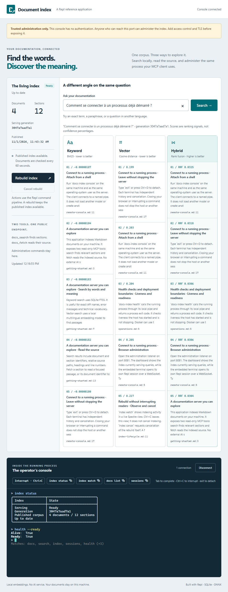
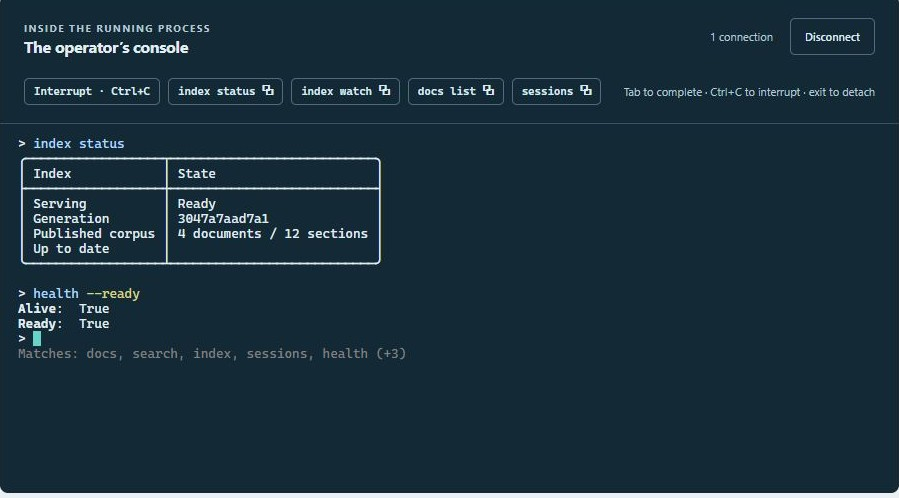
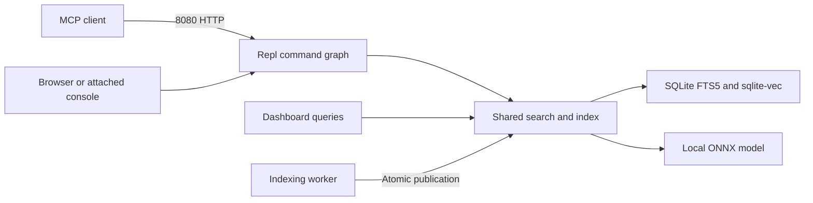

# Documentation index over MCP

Ask a question about your Markdown documents. Compare what keywords find with what meaning finds. Then open a console into the running server and inspect the index that answered you.

This sample connects those experiences in one application:

- **For an agent:** a stateless HTTP MCP server with just search and fetch.
- **For a developer:** a dashboard with keyword, vector and hybrid rankings, source excerpts and a Spectre-powered Repl console.
- **For a container:** a persistent index, shell attachment to the live process and an executable health check.

Embeddings run locally on CPU. No GPU, Python, API key or external AI service is needed. The application retrieves source material; it does not generate answers itself.

> **Trusted administration only.** The admin console has no authentication. Anyone who reaches its port can administer the index. Keep it private. Production exposure requires authentication, authorization, TLS and network restrictions; public MCP search also needs appropriate quotas and abuse protection.

**Start here:** [run it](#run-it) → [take the tour](#take-the-tour) → [connect an agent](#connect-an-agent) → [follow the code](#follow-the-code).

<details>
<summary>See the application: a French question over English documentation</summary>



</details>

## Run it

From the repository root, enter the sample directory. All subsequent shell examples use this directory unless stated otherwise.

```sh
cd samples/10-docs-mcp
```

### With .NET

Requires .NET 10 on Windows x64, Linux x64 or macOS Apple Silicon. The selected ONNX Runtime package does not support macOS Intel; other native targets are not packaged by this sample.

```sh
dotnet run -- assets fetch
dotnet run -- serve
```

The first command downloads verified assets into `.assets`, including an approximately 470 MB model. Allow for that initial download. Later calls reuse files whose checksums match. Serving verifies the assets and works offline; it never downloads missing files automatically.

Leave this terminal running. Open [the administration dashboard](http://127.0.0.1:8081) and wait for **Ready**. On the first start, the worker builds an index of the supplied [documents](documents/).

### With Docker

Requires Docker with Linux containers and Compose. No host .NET installation is needed.

```sh
docker compose up --build -d
docker compose logs -f
```

The image includes the model and browser assets. Compose mounts `./documents` read-only at `/documents`, keeps `/index` in a named volume, and publishes administration on host loopback only. Open the same [dashboard](http://127.0.0.1:8081). Ctrl+C leaves the log viewer; the detached container keeps running.

Choose either native or container execution: their default ports are the same. See [operating the sample](docs/operations.md) for storage, configuration and troubleshooting.

## Take the tour

### 1. Ask the same question in different words

Search for **How do I connect to an existing process?** Then try **Comment se connecter à un processus déjà démarré ?**

The bundled documents are in English. Watch which passages move between the three columns:

| Ranking | What to look for |
| --- | --- |
| Keyword | Matches to the words you supplied; useful for exact names and errors |
| Vector | Related meaning, including across languages |
| Hybrid | Results supported by either branch, with agreement rewarded |

The lists can agree. This is a comparison, not a promise that one method always wins. BM25 and cosine distances sort lower first; fusion scores sort higher first. These scores are **not confidence percentages**.

Select a result. The source reader shows the indexed passage, relative filename, line range and generation. You can check what a search result actually says without leaving the application.

### 2. Inspect the process that answered

In the browser console, run these commands one at a time:

```text
index status
search compare --query "remote console"
health --ready
```

Repl supplies parsing, help and completion; Spectre renders the status and comparison. `health --ready` checks the live host and its published index. This is an actual command session into the server, sharing its search services and worker.



### 3. Rebuild while staying connected

Run `index watch`, then click **Rebuild index** in the dashboard. The button invokes the Repl rebuild command independently of the occupied console. Observe the activity and the new generation after publication. On the small bundled corpus, a rebuild may finish quickly.

The worker prepares a replacement while the previous index remains available. Edit or add a Markdown file in `documents`, rebuild again, then search for its content. Automatic scans also detect changes every 60 seconds.

Use **Interrupt · Ctrl+C**, or Ctrl+C in the terminal, to leave the watch. This stops observation. `index cancel` cancels a rebuild; it preserves the last published generation. Command-copy buttons copy text for you to paste at a prompt.

### 4. Attach from another process

For a native server, open a second terminal in this directory:

```sh
dotnet run -- console
```

For the container:

```sh
docker exec -it docs-index /app/docs-index console
```

Run `sessions` to see browser sessions and local CLI connections. `exit`, Ctrl+D in the local attach client, or browser disconnection detaches that session without stopping the server. The attach client uses a local named pipe: it loads neither another model nor another index.

In Portainer, use `/app/docs-index console` as the custom console command instead of `/bin/sh`, under the container's normal application user. There is no third port, pipe mount or host-to-container pipe bridge.

### 5. Use the same connection for automation

One-shot client mode preserves the remote command's exit code, stdout and stderr:

```sh
dotnet run -- exec docs search --query "connect to a process" --count 3
dotnet run -- health --ready
```

Container equivalents:

```sh
docker exec docs-index /app/docs-index exec index status
docker exec docs-index /app/docs-index health --ready
```

A ready host returns `{"alive":true,"ready":true}` and exit code zero. Docker's built-in health check uses the same executable and pipe for liveness, without curl or a shell. [Liveness and readiness](docs/operations.md#health-and-persistence) serve different purposes.

## Connect an agent

The public listener is **HTTP port 8080, `/mcp`**. Use an MCP client with Streamable HTTP support. A configuration in clients that accept this format is:

```json
{
  "mcpServers": {
    "documentation": {
      "type": "http",
      "url": "http://localhost:8080/mcp"
    }
  }
}
```

Configuration files and keys vary by client. After connecting, check that the discovered tools are exactly:

| Tool | Input | Result |
| --- | --- | --- |
| `docs_search` | `query`, optional `count` | Ranked sections with identifiers, excerpts and source locations |
| `docs_fetch` | `id`, optional `maxChars` | Indexed Markdown, generation and an explicit truncation flag |

Try asking your agent:

> Find how to attach a console to an already running process. Search the documentation, fetch the relevant passage, and cite its source when you explain it.

The agent supplies the answer-generation step. This server supplies retrieval and evidence. Fetch a search result's `id` for its section, or `documentId` for the full page. Fetch is bounded and reports truncation; identifiers refer to the **current** published index, so search again if a rebuild has made an identifier stale.

Only the allowlisted command paths `docs search` and `docs fetch` enter the MCP projection. `index rebuild`, `sessions` and the rest of the administration graph stay outside it. Admin HTTP and WebSocket routes are also unavailable on the public listener.

## Command reference

These commands run inside an attached console, or after `exec` in a one-shot client:

| Command | Purpose |
| --- | --- |
| `docs search --query "remote console"` | Hybrid search; `--count` defaults to 5, maximum 20 |
| `docs fetch --id <identifier>` | Read a document or section; `--max-chars` defaults to 20,000 |
| `docs list` | Inspect document identifiers; page with `--offset` and `--count` |
| `search compare --query "remote console"` | Compare the three rankings in Spectre tables |
| `index status` | Generation, readiness, progress and last failure |
| `index watch` | Live status in an attached terminal; Ctrl+C stops observing |
| `index rebuild` | Request a full rebuild through the shared worker |
| `index cancel` | Cancel rebuilding while retaining the published index |
| `sessions` | List browser sessions and local CLI connections |
| `health --ready` | Require a usable index as well as a running process |

Use `--help` for signatures and `--json` for structured command output. Use `index status` rather than `index watch` for one-shot automation. Spectre uses each session's terminal capabilities and falls back for limited terminals.

## Follow the code



Start with these files, in order:

| Read | The question it answers |
| --- | --- |
| [Program.cs](Program.cs) | How does a process choose server, attach, one-shot or asset-setup mode? |
| [Hosting/Server.cs](Hosting/Server.cs) | Where are services, listeners, Repl and MCP assembled? |
| [Commands.cs](Commands.cs) | Which operations belong to the graph, and which services do they need? |
| [Search/DocumentIndex.cs](Search/DocumentIndex.cs) | How do keyword search, vector search and publication share one database? |
| [IndexingWorker.cs](IndexingWorker.cs) | Who owns rebuilding, cancellation and readiness? |

[Inside the application](docs/architecture.md) follows individual requests, explains the search algorithm and publication boundary, and shows where to extend the sample. [Operating the sample](docs/operations.md) covers your own corpus, settings, health, assets, tests and failures.

These are **advanced hosting integrations**: Repl is one component inside a larger application. A normal Repl application does not need a background indexer, two listeners or remote administration. This reference intentionally favors exact search and full rebuilds over infrastructure for large corpora; its [deployment limits](docs/operations.md#deployment-boundaries) are part of the design.
