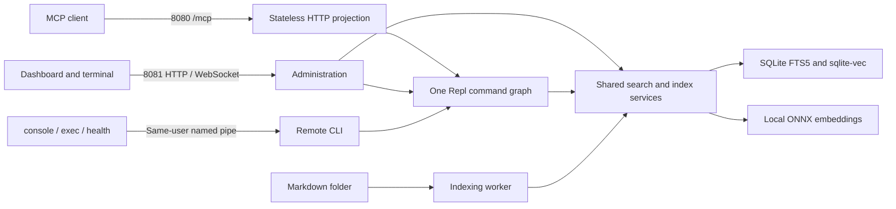

# Documentation index over MCP

A runnable Markdown search server: a small public MCP surface, a richer administration console, and one shared index in one process. Local CPU embeddings complement keyword search; the dashboard makes their different rankings visible.

> **Demo security boundary:** administration has no authentication. Anyone who can reach its port can run administrative commands. Keep it private. Production exposure requires authentication, authorization, TLS and network restrictions. Public MCP search also needs quotas and abuse protection appropriate to your deployment.

<details>
<summary>View the search dashboard and administration console</summary>

The supplied English documents can be searched in French. The dashboard compares keyword, vector and hybrid rankings while the console inspects the same running index.


</details>

## Run locally

Requires .NET 10. The packaged native targets are Windows x64, Linux x64 and macOS Apple Silicon. macOS Intel is not supported by the selected ONNX Runtime NuGet package; the application reports an unsupported-target error rather than attempting a partial setup.

From this directory:

```sh
dotnet run -- assets fetch
dotnet run -- serve
```

The first command explicitly downloads the pinned model, vocabulary, sqlite-vec extension and browser terminal dependencies into `.assets`. Checksums are verified, including on subsequent runs. Server mode verifies the files and runs offline; it never downloads missing assets automatically. No Python, GPU, API key or external AI service is required.

Open [the administration dashboard](http://127.0.0.1:8081). The supplied documents explain the application itself. Try a question such as **“How can I connect to an existing process?”**, then try the same question in French. Select a result to read its indexed source.

The public MCP endpoint is `http://localhost:8080/mcp`. Configure an MCP client that supports Streamable HTTP, for example:

```json
{
  "mcpServers": {
    "documentation": {
      "type": "http",
      "url": "http://localhost:8080/mcp"
    }
  }
}
```

Client configuration formats vary. The endpoint exposes exactly `docs_search` and `docs_fetch`; administration is not available through MCP.

## Run in Docker

From this directory:

```sh
docker compose up --build -d
docker compose logs -f
```

Compose builds a Linux amd64 image and mounts two volumes:

| Mount | Access | Purpose |
| --- | --- | --- |
| `./documents` → `/documents` | Read-only | Markdown corpus; replace the source with your folder |
| Named volume `index` → `/index` | Read/write | Persistent index |

The image runs as a non-root user. Model and browser assets are included at build time, outside the volumes. A bind mount used in place of the index volume must be writable by the image's user. Use local storage; SQLite WAL is not intended for a network filesystem or multiple index writers.

Compose publishes MCP on port 8080 and administration on **host loopback only**, port 8081. Inside the container both listeners bind to container interfaces. Do not replace the admin binding with `8081:8081` on an untrusted host.

```sh
docker exec -it docs-index /app/docs-index console
docker exec docs-index /app/docs-index exec index status
docker exec docs-index /app/docs-index health
docker exec docs-index /app/docs-index health --ready
```

In Portainer, open the container console with the custom command `/app/docs-index console` instead of `/bin/sh`, as the container's normal application user. The pipe stays inside the container: there is no pipe mount, third port or host-to-container pipe bridge.

`health` checks liveness through the live process's local pipe. Docker uses it directly, without curl or a shell. Add `--ready` to require a usable published index. An initial build can be alive without being ready; a failed rebuild can remain ready on its previous generation. Exit code zero means the requested check succeeded.

## Explore the running application

The browser console and `dotnet run -- console` attach to the same application. Each session has its own input, history and cancellation. `exit`, Ctrl+D in the local attach client, or a disconnected browser ends that session, not the server.

| Command | Purpose |
| --- | --- |
| `docs search --query "remote console"` | Hybrid search; `--count` defaults to 5, maximum 20 |
| `docs fetch --id <identifier>` | Read a document or section; `--max-chars` defaults to 20,000 |
| `docs list` | Inspect document identifiers; page with `--offset` and `--count` |
| `search compare --query "remote console"` | Compare keyword, vector and hybrid results using Spectre |
| `index status` | Published generation, readiness, progress and last failure |
| `index watch` | Live Spectre status; Ctrl+C stops observation only |
| `index rebuild` | Request a full rebuild through the shared worker |
| `index cancel` | Cancel a rebuild, retaining the last published index |
| `sessions` | Browser sessions and local CLI connections |
| `health --ready` | Require a usable index as well as a running process |

Use `--help` to inspect the exact command signatures. `--json` selects structured output. Live `index watch` requires an attached terminal; use `index status` for one-shot automation. The browser's Interrupt button sends the same Ctrl+C control character, including on touch devices. Spectre rendering uses the current session's terminal capabilities and falls back for limited terminals.

One-shot client mode also preserves the remote command's exit code, stdout and stderr:

```sh
dotnet run -- exec docs search --query "connect to a process"
```

The browser console renders `index status` with Spectre and runs `health --ready` against the live process:


## How the pieces fit



`Program.cs` selects client/server mode and owns the server lifetime. `Hosting/Server.cs` composes services, the graph and the HTTP surfaces. `Search` contains the document, embedding and index logic; the command and endpoint adapters call those same services. The dashboard has JSON endpoints for status, comparison and fetch. Rebuild/cancel buttons invoke the corresponding Repl commands through the same programmatic backend as the local CLI, independently of any active console command. Console helpers copy command text without injecting it into your input.

These are **advanced hosting integrations**, useful when Repl is a small part of a larger application. A normal Repl application does not need two listeners, a background indexer or remote administration.

### Search

Markdig supplies heading structure and unique anchors. Paragraphs and other blocks are combined into token-bounded sections; oversized blocks are split without cutting surrogate pairs. Source paths and line ranges remain attached to each section. Headings are metadata; fetch preserves the indexed Markdown content. Symbolic links are skipped, and fetch accepts indexed identifiers rather than filesystem paths.

The pinned `intfloat/multilingual-e5-small` model uses XLM-R token IDs, the prefixes `query:` and `passage:` followed by a space, masked mean pooling and L2 normalization. The complete input must fit its 512-token window; an overlong query is rejected explicitly. The model produces 384-dimensional vectors.

SQLite FTS5 supplies keyword ranking. sqlite-vec performs exact cosine nearest-neighbor search. The hybrid list adds `1 / (60 + rank)` from each branch, using one-based ranks and deterministic identifier tie-breaking. Each branch considers at least 20 candidates, or four times the requested result count. BM25 and cosine distances sort ascending; fusion scores sort descending. None is a confidence probability.

### Index lifecycle

One background worker scans content hashes initially and every 60 seconds. Added, edited or removed documents trigger a full rebuild. Replacement rows and embeddings are prepared in a staging SQLite database on disk. The worker checks the source fingerprint again before publication; a changing corpus is retried on a later scan.

Publication replaces document, keyword and vector rows in one transaction with WAL enabled. Search and fetch use read transactions; readers cannot observe half a generation. Cancellation or failure retains the published index. Concurrent manual requests are coalesced; a request during an active rebuild reports that work is already running.

A compatible index serves immediately after restart while the worker checks the corpus. Metadata records model identity and schema version. An incompatible generation is not served and is rebuilt; this sample does not implement schema migrations. If a future schema cannot be opened, stop the service and recreate the disposable index volume from the source documents.

### Startup, callbacks and cleanup

1. Client modes are selected before the web host, model or index services are constructed.
2. Server mode validates configuration and verified assets. The host registers singleton search/index services, one worker and one lazily configured Repl application.
3. Resolving the Repl application applies its embedded profile, output format and static command graph. The named-pipe listener is created, then the host starts its HTTP listeners and worker. Liveness is false until host startup completes.
4. Each MCP HTTP request projects only the two allowlisted commands using its request services. Each WebSocket gets an ASP.NET request scope, explicitly borrowed by Repl using `RunWithServicesAsync` and `CallerOwned`. Pipe terminals get their own scopes through the remote backend.
5. Terminal negotiation establishes capabilities and dimensions; ordinary Repl invocation hooks then surround command execution. The worker owns indexing cancellation; the session owns command/watch cancellation. Host logs remain separate from terminal output.
6. Host shutdown rejects new HTTP work and cancels active sessions. Pipe connections, HTTP sessions and the worker stop before shared services are disposed. Cleanup has a 15-second outer deadline; a failure terminates the process instead of disposing the model beneath active work.

See [advanced input hooks](../../docs/advanced-input.md), [MCP HTTP request ordering](../../docs/mcp-transports.md#startup-and-request-order) and [Spectre screen ownership](../../docs/interaction.md#spectre-and-screen-ownership) for the framework contracts.

## Configuration

Environment variables are shared by native and container execution:

| Variable | Native default |
| --- | --- |
| `DOCS_DOCUMENTS` | `documents` relative to the current directory |
| `DOCS_INDEX` | `.index` relative to the current directory |
| `DOCS_ASSETS` | `.assets` relative to the current directory |
| `DOCS_PIPE` | `repl-docs-index` |
| `DOCS_MCP_PORT` | `8080` |
| `DOCS_ADMIN_PORT` | `8081` |
| `DOCS_ADMIN_ADDRESS` | `127.0.0.1` |
| `DOCS_ADMIN_ORIGIN` | No additional browser origin |

Use the same `DOCS_PIPE` in server and client processes. Give simultaneous instances different pipes, ports and index directories. The public MCP listener binds to network interfaces; publishing it is a deployment decision. Listener separation uses the actual local port, not the request's Host header.

Browser administration accepts the local HTTP origins `localhost`, `127.0.0.1` and `[::1]` on the configured admin port. Set `DOCS_ADMIN_ORIGIN` to one additional exact HTTP(S) origin, without a trailing slash, when using a proxy or another hostname. Foreign and opaque (`null`) origins are rejected before HTTP actions or WebSocket acceptance. Native clients without an Origin header remain allowed. This browser-origin boundary is not authentication; clients can omit or forge headers.

The sample intentionally omits authentication, authorization policy, TLS termination, rate limits, distributed storage, incremental indexing and approximate nearest neighbors. It targets modest corpora; exact vector search and complete rebuilds trade scalability for code that is easy to inspect. Each Markdown file is limited to 8 MiB, search to 2,000 characters and 20 results, and fetch to 20,000 characters. Do not treat the sample as a hardened Internet-facing deployment.

## Assets and verification

`assets.json` records immutable URLs and SHA256 checksums. The ONNX model and vocabulary are MIT-licensed; sqlite-vec is MIT/Apache-2.0; xterm and its fit addon are MIT-licensed. ONNX Runtime licensing and notices travel with its NuGet package. Upstream references: [model card](https://huggingface.co/intfloat/multilingual-e5-small), [sqlite-vec](https://github.com/asg017/sqlite-vec), [ONNX Runtime](https://github.com/microsoft/onnxruntime), [xterm.js](https://github.com/xtermjs/xterm.js).

The test project runs deterministic chunking and ranking checks without assets. Set `DOCS_TEST_ASSETS` to an absolute verified assets directory to enable SQLite, HTTP, pipe and real-model checks:

```sh
dotnet test --project ../../src/Repl.DocsSampleTests/Repl.DocsSampleTests.csproj
```

The real-model test compares exact token IDs and cosine agreement against stored reference vectors produced with the model's PyTorch implementation. No reference-generation toolchain is required to run these tests. The dedicated sample workflow fetches verified assets and enables those tests explicitly on each packaged target.
