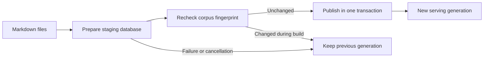

# Inside the application

[Run the sample and take the tour](../README.md) · [Configuration and troubleshooting](operations.md)

The central design choice is ownership: one process owns a model, an index and a rebuilding worker. Transports expose ways to use that state. Connecting another console does not create another application.

## Where the boundaries are

| Entry point | Route into the application | Lifetime |
| --- | --- | --- |
| Public MCP, port 8080 | Only `docs search` and `docs fetch`, projected from the Repl graph | Stateless HTTP requests |
| Browser console, port 8081 | WebSocket-backed Repl session with the administration graph | One session per connection |
| Local `console` | Remote Repl terminal over a same-user named pipe | One session per attachment |
| Local `exec` or `health` | Programmatic invocation through that pipe | One command per client process |
| Dashboard, port 8081 | Status, comparison and fetch call shared services; rebuild/cancel invoke Repl commands | HTTP requests |

The HTTP listener boundary uses the connection's actual local port. Changing a Host header cannot turn the public endpoint into an admin endpoint. The MCP allowlist is separate from a command's read-only annotation: adding `.ReadOnly()` does not expose another tool automatically.

### A search request, end to end

Follow `docs_search` from an MCP client:

1. [Server.cs](../Hosting/Server.cs) configures the MCP SDK's stateless HTTP transport. For each request, `ConfigureSessionOptions` projects the allowlisted commands using `HttpContext.RequestServices`.
2. Repl binds the tool input to the `docs search` handler in [Commands.cs](../Commands.cs), resolving `DocumentIndex`, `IndexingWorker` and cancellation from the request context. Application dependencies carry `[FromServices]` so discovery does not present them as user arguments.
3. The handler checks readiness and calls [DocumentIndex.Search](../Search/DocumentIndex.cs). This is the same search used by the dashboard and `search compare`.
4. The query becomes a local embedding. A SQLite read transaction collects keyword and vector candidates from one published generation, then fuses their ranks.
5. The MCP projection returns the hybrid hits. The agent can call `docs_fetch` with a returned identifier to read the source.

The two tool calls are independent requests. A rebuild can publish between search and fetch. Fetch returns its current generation; if a section identifier no longer exists, the caller should search again. A generation is a publication boundary, not a durable snapshot token for a multi-call conversation.

### A console command, end to end

For a browser connection, [Endpoints.cs](../Hosting/Endpoints.cs) accepts the WebSocket and lends the ASP.NET request's services to `ReplWebSocketSession.RunWithServicesAsync`. `SessionScopeBehavior.CallerOwned` keeps Repl from disposing or replacing that connection scope. The host still owns the singleton index and worker.

The browser sends terminal metadata and keystrokes through the [shared terminal client](../../shared/terminal-client.js). Repl handles input, command binding and session cancellation. [ConsoleViews.cs](../ConsoleViews.cs) supplies the sample's Spectre layouts; JSON and MCP results remain structured data.

The sample decorates the existing `spectre` transformer rather than creating another format. Its index, comparison and source views are custom; other values, including the rich help model for `help` and `?`, pass through to Spectre. Retaining the format also retains its help factory and banner settings.

The embedded-console profile disables `exit` by default. This sample explicitly enables it in [Server.cs](../Hosting/Server.cs): `exit` ends the attached session and closes its WebSocket, while the host, index and other sessions keep running. The browser can connect again to open a new session.

The local attach client follows a different transport to the same graph: [ClientMode.cs](../Hosting/ClientMode.cs) connects to `NamedPipeReplServer`, whose backend is `ReplAppRemoteBackend`. Client mode runs before the web host is constructed, so an attachment cannot accidentally start another listener or load another model.

## How the search works

### Markdown becomes bounded passages

[MarkdownCorpus.cs](../Search/MarkdownCorpus.cs) enumerates Markdown files, skipping symbolic links. Relative paths and file contents form the corpus fingerprint; filenames alone are insufficient to detect edits.

Markdig supplies heading structure and unique anchors. Headings become passage metadata. Paragraphs and other blocks are combined up to the model's token window; oversized blocks are split without cutting surrogate pairs. Every section retains its source path, heading, anchor and line range. The original page is also stored for whole-document fetch.

Document identifiers hash relative paths. Section identifiers add a bounded hash of the heading anchor and a part number. They are identifiers to fetch from the index, not filesystem paths. Editing the structure can change which passage an identifier describes; callers should retain source and generation information when citing results.

### Text becomes a local vector

[E5Embedding.cs](../Search/E5Embedding.cs) uses the pinned `intfloat/multilingual-e5-small` ONNX model:

1. Prefix queries with `query:` and passages with `passage:`, each followed by a space.
2. Tokenize with the SentencePiece vocabulary and map IDs to XLM-R's fairseq ordering, including start/end markers.
3. Run the model on CPU, with an attention mask covering the input tokens.
4. Mean-pool the token states and normalize the resulting 384-dimensional vector to unit length.

The complete input, including prefix and markers, must fit 512 tokens. Corpus chunking respects that budget. An oversized query is rejected explicitly rather than silently truncated. Tokenization is synchronized; each inference owns its cancellation-aware run options. ONNX Runtime telemetry is disabled.

The [real-model regression](../../../src/Repl.DocsSampleTests/Given_E5Embedding.cs) checks exact token IDs and vector agreement with stored reference output from the model's PyTorch implementation. Tests need no reference-generation toolchain.

### Two rankings become one

SQLite holds the data together:

| Table | Responsibility |
| --- | --- |
| `documents` | Indexed page text and document metadata |
| `sections` | Bounded passages and source locations |
| `keywords` | FTS5 index of title, heading and passage text |
| `vectors` | sqlite-vec vectors keyed to section rows |
| `metadata` | Published generation, corpus fingerprint, model identity and schema version |

Keyword search extracts letter/digit/underscore terms and joins quoted terms with OR. FTS5 BM25 weights title, heading and body by 3, 2 and 1. Vector search asks sqlite-vec for exact cosine nearest neighbors. Each branch considers at least 20 candidates, or four times the requested result count.

Reciprocal rank fusion adds `1 / (60 + rank)` from each branch, using one-based ranks. For illustration, a passage ranked first by keywords and third by vectors scores `1/61 + 1/63`, approximately `0.0323`. This combines positions rather than trying to compare BM25 directly with cosine distance. Ties in the fused list use the section identifier for deterministic ordering.

The dashboard shows each branch separately as well as the fused result. A keyword-only hit can still appear in hybrid search. A vector result is a retrieval candidate, not proof that the passage answers the question.

## Rebuilding without exposing half an index

[IndexingWorker.cs](../IndexingWorker.cs) is the only rebuild owner. It scans initially and every 60 seconds, or after a manual request. Requests are coalesced; a request during an active build reports that work is already running.

The worker is also the only writer of its immutable status. It publishes status and the current cancellation action together with `Volatile.Read/Write`; readers need no worker lock or retry loop. Concurrent cancellation callers atomically complete a per-build signal with `TrySetResult` and share the task that forwards cancellation. Finishing a build closes that signal and awaits forwarding before disposing the token source, so a caller holding an older snapshot cannot cancel a later build or touch a disposed source. The channel and .NET cancellation primitives still manage their own internal synchronization.



Embedding work and replacement rows are prepared on disk outside the live database's writer transaction. The replacement fingerprint accumulates the exact ordered source paths and document text written to staging. Before publication, it is compared with a fresh corpus scan. A mismatch rejects the replacement and a later scan can retry, including when a file was edited and restored while its transient content was being embedded.

Publication copies document, section, keyword and vector rows plus generation metadata in one transaction. SQLite WAL and read transactions let a search or fetch see a coherent generation. Cancellation before commit rolls back publication; staging files are removed when the operation unwinds.

The first build has no previous generation to serve. Once a generation exists, a failed or cancelled rebuild can leave the application ready on that generation, with the failure visible in `index status`. A compatible warm index becomes available while the worker checks for source changes.

## Startup, hooks and shutdown

Read [Program.cs](../Program.cs), [Server.cs](../Hosting/Server.cs) and [ServerLifetime.cs](../Hosting/ServerLifetime.cs) together:

1. Choose asset setup, attach, one-shot or server mode. Client modes exit before creating the host.
2. In server mode, validate paths and listener configuration, then verify the pinned assets.
3. Register singleton search/index services, the hosted worker and a lazily configured Repl application. Resolving Repl applies its embedded profile, output format and static graph.
4. Create the named-pipe listener, then start the host's HTTP listeners and worker. Liveness requires host startup to have completed; readiness also requires a published index.
5. For MCP, configure the projection per HTTP request. For WebSockets, borrow the request scope for the connection. Pipe terminals get their scopes through the remote backend. Terminal negotiation supplies capabilities and dimensions before interactive use; ordinary invocation hooks surround command execution.
6. On shutdown, reject new HTTP work and cancel active sessions. Stop pipe connections, the host and worker before disposing shared services. A 15-second outer cleanup deadline terminates the process on failure instead of disposing the model beneath active work.

Cancellation has distinct owners:

| Action | What stops |
| --- | --- |
| Ctrl+C / Interrupt during `index watch` | That session's observation command |
| `index cancel` | The shared active rebuild |
| Disconnect or `exit` | That terminal session |
| Stop the server/container | The host, worker and its sessions |

During the live Spectre view, the presenter captures Repl interaction events so they do not compete for the screen. Explicit async flushes send Spectre's buffered synchronous output through hosted writers. Limited terminals get changed status snapshots instead of live cursor updates.

Framework contracts: [advanced input hooks](../../../docs/advanced-input.md), [MCP startup/request ordering](../../../docs/mcp-transports.md#startup-and-request-order), [Spectre screen ownership](../../../docs/interaction.md#spectre-and-screen-ownership) and [borrowed WebSocket services](../../../src/Repl.WebSocket/README.md).

## Make it yours

Start by replacing the corpus; you do not need to change the transports. Then choose the seam that corresponds to your change:

| Change | Start here | Keep in mind |
| --- | --- | --- |
| Add an administrative command | [Commands.cs](../Commands.cs) | It remains outside MCP unless explicitly allowlisted |
| Expose an additional public operation | [Server.cs](../Hosting/Server.cs) MCP filter | Review both discovery and server-side invocation boundaries |
| Change passage boundaries | [MarkdownCorpus.cs](../Search/MarkdownCorpus.cs) | Preserve token bounds, Unicode and source locations |
| Try another embedding model | [ITextEmbedding](../Search/Models.cs), [E5Embedding.cs](../Search/E5Embedding.cs), [assets.json](../assets.json) | Change identity, dimensions and tokenization together; rebuild the index |
| Change fusion or candidate selection | [DocumentIndex.cs](../Search/DocumentIndex.cs) | Keep the comparison view and ranking regressions aligned |
| Customize terminal presentation | [ConsoleViews.cs](../ConsoleViews.cs) | Keep structured results independent of terminal rendering |

For example, an administrator-only status shortcut can be added inside `Commands.Map`:

```csharp
repl.Map("index generation", ([FromServices] IndexingWorker worker) => worker.Status.Generation?.Id)
    .WithDescription("Show the currently published generation identifier.")
    .ReadOnly();
```

It is available through the administration graph and one-shot client. It does not become a public MCP tool: the projection's explicit allowlist is still the boundary. The [sample tests](../../../src/Repl.DocsSampleTests/) show how to substitute a tiny deterministic embedding implementation while exercising the actual worker and transports.
